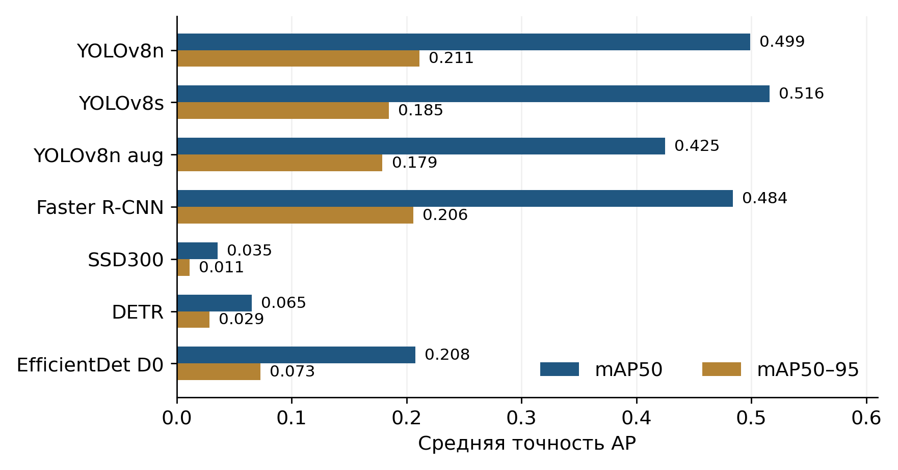
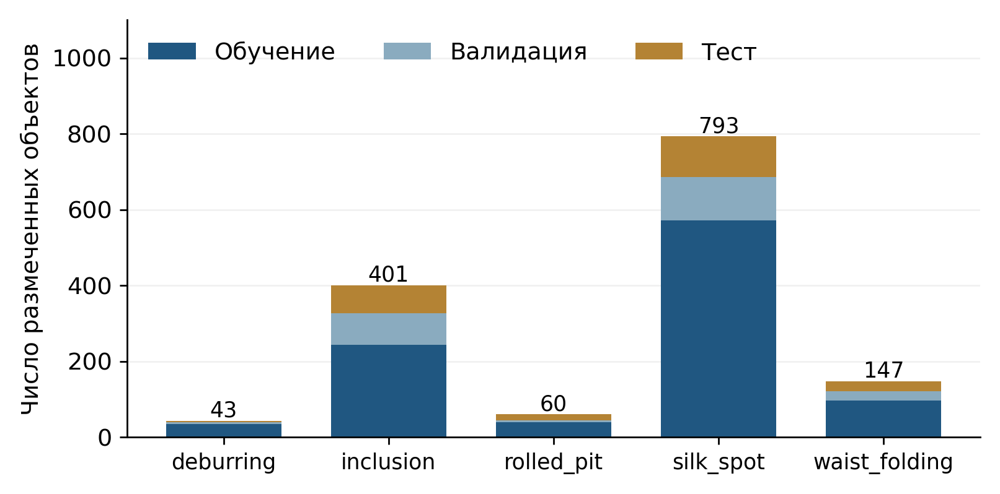
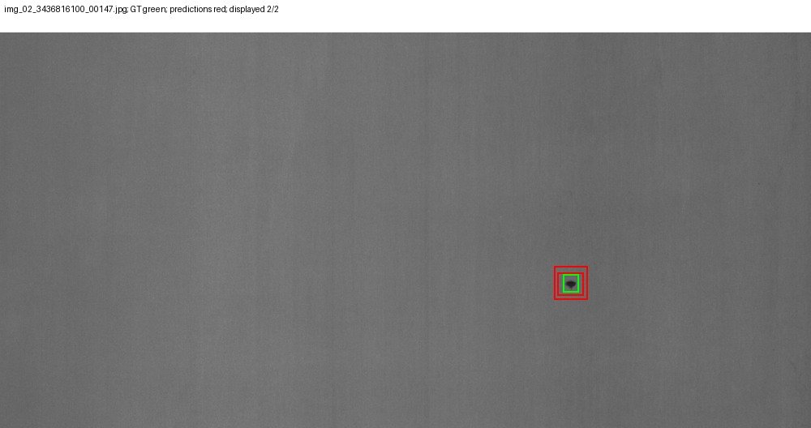
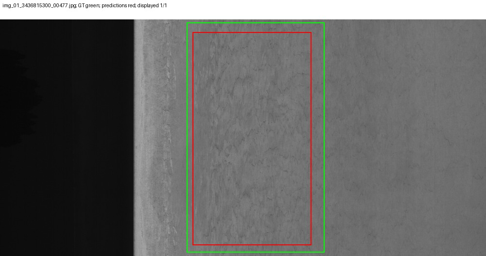

## Что это?

Проект по проектному практикуму, посвящённый сравнению моделей детекции дефектов металлической поверхности. Модель получает изображение металла, определяет тип дефекта и выделяет его прямоугольной рамкой.

Для работы выбран датасет [c5data2](https://www.kaggle.com/datasets/niclinn/c5data2): 1075 изображений, 1444 объекта и пять классов — `deburring`, `inclusion`, `rolled_pit`, `silk_spot`, `waist_folding`.

Сравниваются пять семейств моделей: YOLOv8, Faster R-CNN, SSD, DETR и EfficientDet. Всего проведено семь экспериментов: YOLOv8n, YOLOv8s, YOLOv8n с усиленной аугментацией и четыре остальные модели. Все итоговые показатели рассчитаны на одной тестовой выборке из 162 изображений.

## Что внутри?

| Файл / папка | Описание |
|-------------|----------|
| `main.py` | Единая точка запуска оценки и нового обучения |
| `notebooks/` | Исходные сохранённые ноутбуки проекта |
| `src/` | Подготовка данных, модели, обучение, расчёт метрик и построение графиков |
| `configs/pipeline/` | Отдельная конфигурация каждого из семи экспериментов |
| `configs/experiment_provenance.json` | Фактические условия исходного обучения и внесённые исправления |
| `requirements.txt` | Зафиксированные версии библиотек |
| `comparison_table.csv` | Итоговая таблица сравнения семи экспериментов |
| `results/final/` | Проверенные метрики, предсказания, разметка, графики и примеры обнаружений |
| `results/reference/` | Эталонные показатели, истории обучения и списки файлов датасета |
| `assets/` | Общие графики для README и примеры датасета |
| `show_results.py` | Просмотр готовой таблицы без установки ML-библиотек |
| `recheck_saved_metrics.py` | Повторный расчёт метрик по сохранённым предсказаниям |
| `restore_release_assets.py` | Возвращает данные и веса из архивов Releases на нужные места |
| `data/README.md` | Источник данных, разбиение и порядок восстановления датасета |
| `docs/Report_metal_surface_defects.docx` | Подробный отчёт по работе |
| `docs/Metal_surface_defects_presentation.pptx` | Презентация с метриками, графиками и примерами |
| `docs/PROJECT_HISTORY.md` | Последовательность работы, проблемы и решения |
| `docs/LITERATURE.md` | Научные статьи и документация, использованные в проекте |
| `final_output.txt` | Краткий вывод по работе |

## Для запуска?

Требования:

● Python 3.11 — рекомендуемая версия для этого комплекта.

● Библиотеки: PyTorch, torchvision, Ultralytics, Transformers, effdet, timm, NumPy, SciPy, Pillow, Matplotlib и PyYAML. Версии указаны в `requirements.txt`.

● Для повторной оценки нужны сохранённые веса и подготовленный датасет. Они размещаются в [Releases](https://github.com/vlukyanov07hv-netizen/ProjectPracticum/releases), а исходники, метрики и графики — в самом репозитории.

● Для просмотра уже полученных результатов достаточно Python. CUDA и переобучение для этого не нужны.

## 1. Клонируй репозиторий

```bash
git clone https://github.com/vlukyanov07hv-netizen/ProjectPracticum.git
```

## 2. Перейди в репозиторий

```bash
cd ProjectPracticum
```

Готовую таблицу можно посмотреть сразу:

● для Windows:

```bat
python show_results.py
```

● для macOS/Linux:

```bash
python3 show_results.py
```

## 3. Подготовь данные и веса

Скачай из Releases архив `dataset.zip` и семь архивов `weights_*.zip`. Помести их в папку `release_assets` в корне репозитория. Для нового обучения EfficientDet дополнительно нужен архив `efficientdet_pretrained.zip`.

● для Windows:

```bat
python restore_release_assets.py --assets release_assets
```

● для macOS/Linux:

```bash
python3 restore_release_assets.py --assets release_assets
```

Скрипт проверяет контрольные суммы архивов и распаковывает их относительно корня проекта: изображения и YOLO-разметка окажутся в `data/raw/`, обученные модели — по путям из конфигураций.

Сохраняется исходное разбиение: train — 752 изображения, val — 161, test — 162. Его не нужно создавать заново. Перезапуск исторического конвертера XML может дать другой состав выборок: одного `seed=42` недостаточно при другом порядке файлов.

## 4. Установи и активируй venv

● для Windows — в обычной командной строке или Anaconda Prompt:

```bat
python -m venv .venv
.venv\Scripts\activate.bat
```

● для macOS/Linux:

```bash
python3 -m venv .venv
source .venv/bin/activate
```

Если уже используется рабочая среда `cv-project`, этот шаг можно пропустить и активировать её:

```bash
conda activate cv-project
```

## 5. Установи зависимости

Сначала установи согласованные версии PyTorch и torchvision.

● для Windows/Linux с NVIDIA — исходный вариант CUDA 12.1:

```bash
python -m pip install torch==2.5.1 torchvision==0.20.1 --index-url https://download.pytorch.org/whl/cu121
```

● для Windows/Linux без NVIDIA:

```bash
python -m pip install torch==2.5.1 torchvision==0.20.1 --index-url https://download.pytorch.org/whl/cpu
```

● для macOS:

```bash
python -m pip install torch==2.5.1 torchvision==0.20.1
```

Затем установи остальные зависимости:

```bash
python -m pip install -r requirements.txt
```

Для команды `show_results.py` установка этих библиотек не нужна. Для `recheck_saved_metrics.py` достаточно NumPy.

## 6. Запусти оценку модели

Например, YOLOv8s на CPU:

```bash
python main.py --model yolo_s --mode eval --split test --device cpu
```

На NVIDIA GPU:

```bash
python main.py --model yolo_s --mode eval --split test --device cuda:0
```

Все семь экспериментов:

```bash
python main.py --model all --mode eval --split test --device cuda:0
```

На Mac и на компьютере без NVIDIA используй `--device cpu`. Полная оценка всех моделей на CPU занимает существенно больше времени; для демонстрации можно запустить одну модель.

Допустимые имена моделей: `yolo_n`, `yolo_s`, `yolo_aug`, `faster_rcnn`, `ssd`, `detr`, `efficientdet`, `all`.

Результат каждого нового запуска сохраняется в отдельной папке `results/runs/`: `metrics.json`, `predictions.json`, `ground_truth.json`, `config_used.json`, `environment.json`, графики и примеры обнаружений. Архив итогового эксперимента в `results/final/` остаётся доступным для сравнения.

## 7. Проверь готовые результаты или запусти новое обучение

Повторный расчёт метрик по сохранённым предсказаниям, без весов, изображений и запуска нейросетей:

```bash
python recheck_saved_metrics.py
```

Новое обучение, если оно нужно:

```bash
python main.py --model yolo_n --mode train --epochs 50 --device cuda:0
```

Это создаёт новый эксперимент. Команды `eval`, `show_results.py` и `recheck_saved_metrics.py` обучение не запускают. Условия новых запусков следует отличать от исторических настроек Colab; они описаны в `configs/experiment_provenance.json`.

## Какие результаты?

| Модель | mAP50 | mAP50–95 | Precision | Recall | F1 |
|--------|-------|----------|-----------|--------|----|
| YOLOv8n | 0.4991 | 0.2111 | 0.5268 | 0.5221 | 0.5244 |
| YOLOv8s | 0.5157 | 0.1848 | 0.5581 | 0.5310 | 0.5442 |
| YOLOv8n + augmentation | 0.4250 | 0.1791 | 0.5347 | 0.4779 | 0.5047 |
| Faster R-CNN | 0.4840 | 0.2060 | 0.1946 | 0.7345 | 0.3077 |
| SSD300 (scratch) | 0.0355 | 0.0112 | 0.0988 | 0.1416 | 0.1164 |
| DETR | 0.0654 | 0.0287 | 0.0545 | 0.2080 | 0.0863 |
| EfficientDet-D0 | 0.2078 | 0.0731 | 0.3258 | 0.1903 | 0.2402 |

YOLOv8s получил лучший mAP50 и F1. YOLOv8n получил лучший mAP50–95, а Faster R-CNN — лучший Recall, одновременно дав 687 ложных обнаружений. Усиленная аугментация YOLOv8n не улучшила результат в данном запуске.



Метрики mAP50 и mAP50–95 рассчитаны общим оценщиком с 101 точкой полноты и максимумом 100 обнаружений каждого класса на изображение. Precision, Recall и F1 — micro-метрики при `confidence=0.25` и `IoU=0.50`.

## Какие данные?

| Выборка | Изображения | Объекты |
|---------|-------------|---------|
| Train | 752 | 985 |
| Validation | 161 | 233 |
| Test | 162 | 226 |
| Всего | 1075 | 1444 |

Разметка исходного датасета была преобразована из Pascal VOC XML в YOLO TXT. Имя класса определялось по папке, координаты нормализовались относительно реальной ширины и высоты изображения. Порядок классов одинаковый для всех моделей.



Датасет несбалансирован: `silk_spot` встречается чаще остальных классов, а в test у `deburring` только три объекта. Это нужно учитывать при сравнении результатов по отдельным классам.

## Как выглядят обнаружения?

Примеры YOLOv8s на тестовой выборке. Зелёные рамки — истинная разметка, красные — обнаружения модели при `confidence >= 0.25`.





Остальные классы, ошибки и результаты других моделей находятся в `results/final/<model>/examples/` и в презентации.

## Что важно при сравнении?

YOLO обучались 50 эпох, остальные модели — 10. Различались размеры входа, инициализация и правило выбора checkpoint. SSD обучался с нуля; Faster R-CNN, исправленный DETR и EfficientDet использовали предобучение. Сравнение показывает результаты конкретных запусков на данном датасете и не доказывает превосходство архитектуры при одинаковом вычислительном бюджете.

Старый DETR с ошибкой нормализации рамок исключён; в итоговой таблице используется исправленная модель. Для SSD сохранены свидетельства влияния настроек cuDNN и актуальная повторная оценка тех же весов. На другом устройстве возможны небольшие численные отличия; точное повторение проверялось в исходной среде Windows / RTX 3050. FPS в работе не измерялся.

Подробная последовательность работы, включая первоначальные шаги с DeepSeek, выбор датасета, литературу, проблемы и исправления, записана в [истории проекта](docs/PROJECT_HISTORY.md) и [отчёте](docs/Report_metal_surface_defects.docx).
